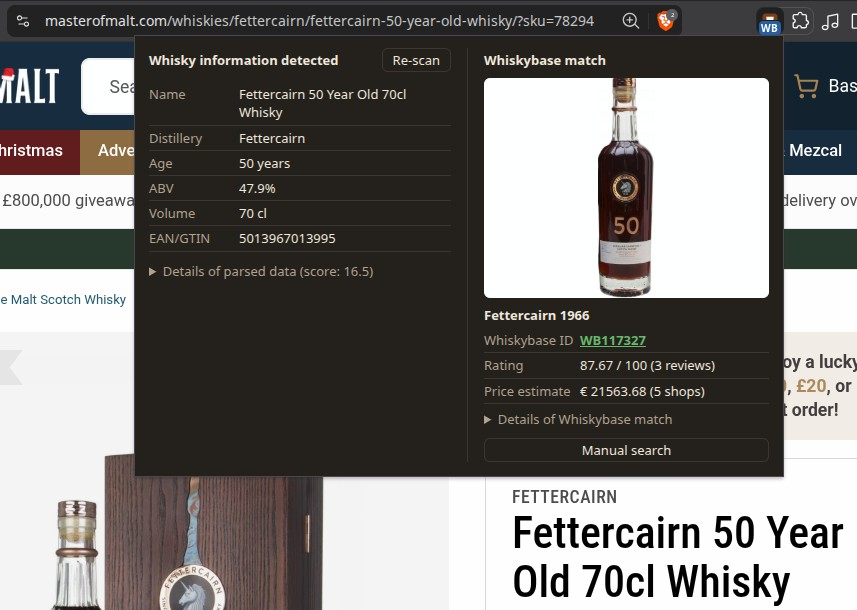

# Bottle lookup for Whiskybase

Browser extension that recognises when the current web page contains details for a bottle of whisky, tries to automatically recognise the relevant details from the page, and looks the bottle up on whiskybase.com. This extension works on all Chromium-based browsers, including: Google Chrome, Microsoft Edge, Brave, Chromium, Opera, and Vivaldi.

🌐 [Download here from the Google Chrome Store](https://chromewebstore.google.com/detail/bottle-lookup-for-whiskybase/nngkmbiongkmhiiiblajjiokfllneomm) (see further down for other installation options)   

Once you've installed the extension: navigate to a page describing a bottle of whisky (e.g. an online shop or auction). Then click the extension's toolbar icon on a page to see what it can do. If you don't see the extension in your browser's toolbar: make sure to pin it. For most browsers, this works by clicking the puzzle piece icon 🧩 top-right corner next to the address bar, and click the pin icon 📌 next to the extension.

By default, the extension only analyses the current web page when you click its icon, but you can easily tell it to do so automatically for every page that loads. When the extension is triggered, the icon in the toolbar shows whether it was able to recognise any information, and whether it was able to link it to a bottle on Whiskybase.com. Click the extension icon to see the extracted details: distillery, bottle name, bottler, age, ABV, volume, vintage/bottled year, cask number, etc. 

**Please note**: This is an independent project; it is not affiliated with nor endorsed by Whiskybase. 

## Installation instructions

### Easiest installation: through Chrome Web Store

The easiest way to install this browser extension is through the Chrome Web Store: [see here](https://chromewebstore.google.com/detail/bottle-lookup-for-whiskybase/nngkmbiongkmhiiiblajjiokfllneomm). It may take a few days for a new version to appear there, after it has been released here on GitHub.

Don't forget to pin the extension (puzzle-piece icon → pin) so you can see the icon in your browser toolbar (top right).

### Installation using an official release from GitHub

1. Download `whiskybase-chromium-browser-extension-<version>.zip` from [the latest release published on this repository](https://github.com/sj/whiskybase-chromium-browser-extension/releases/latest).
2. Unzip the downloaded file in a location of your choosing
3. Navigate to `chrome://extensions` and switch on **Developer mode** (top right).
4. Click **Load unpacked** and select the location at which you've just extracted the release zip file.
5. Don't forget to pin the extension (puzzle-piece icon → pin) so you can see its badge.

### Advanced installation instructions: using a development version

Follow the instructions above, but instead of downloading a release zip file: clone the Git repository to a location of your choosing. Then select that directory when you click **Load unpacked**.

## Some notes on the Whiskybase lookup

Whiskybase has no public API, so the extension uses Whiskybase's own search. It does this in the background, using your browser's cookies for Whiskybase. You don't have to be logged in to Whiskybase for this browser extension to work, but logging in might help with search rate limiting.

The extension only reaches out to Whiskybase if and when it has detected a whisky bottle with at least 90% confidence. You can always perform a manual Whiskybase search straight from the extension; this will open a new tab with Whiskybase search results.

## Did your bottle not get detected on a page?

Did the extension miss a bottle on a page? Or did it get its details wrong? Or was it unable to match it to the right Whiskybase entry? Please
[open a GitHub issue](https://github.com/sj/whiskybase-chromium-browser-extension/issues/new?template=detector.yml)
with the **Bottle detected wrongly on page** form (you will need a GitHub account). It asks for a saved copy of the page, the bottle's distillery and ABV, and any other details you know.

## Any other issues?

If anything else is wrong, or if you have any suggestions that could make this extension better? Let us know by [reporting an issue here](https://github.com/sj/whiskybase-chromium-browser-extension/issues/new/choose) (you will need a GitHub account).

## Privacy

The extension doesn't collect, track or share anything. It has no analytics, no
servers of its own, and doesn't send anything about you or the pages you visit
to anyone, except for the Whiskybase lookups described below.

- **Reading pages.** The extension reads the page you're on to look for details
  of a whisky bottle. By default it only does so when you click its icon; with
  **Check every page automatically** turned on, it reads every page as it loads.
  This happens entirely inside your browser.
- **Whiskybase lookups.** When the extension is confident it has found a bottle,
  or when you click **Manual search**, it searches Whiskybase for it, then
  fetches the matching bottle's page and photo. These requests contain only the
  search terms made from the bottle's details (such as distillery, name, age and
  ABV) and the Whiskybase pages for the match. The address of the page you're on
  is not sent. The requests go to whiskybase.com
  directly from your browser with your Whiskybase cookies, just like visiting
  the site yourself. So if you are logged in to Whiskybase, Whiskybase can see
  that these searches came from your account.
- **Storage.** Results are kept in the browser's session storage while you
  browse, so the same bottle isn't looked up twice. They are cleared when you
  close the browser. Only your settings, such as **Check every page
  automatically**, are stored permanently.
- **Links.** The About & feedback links and the right-click menu entries just
  open GitHub pages in a new tab when you click them.

## Licence

The extension is released under the [MIT licence](LICENSE.md). The saved web
pages in `test/fixtures/` and the images in `screenshots/` show other websites,
whose content belongs to their owners; they are not covered by the licence.

